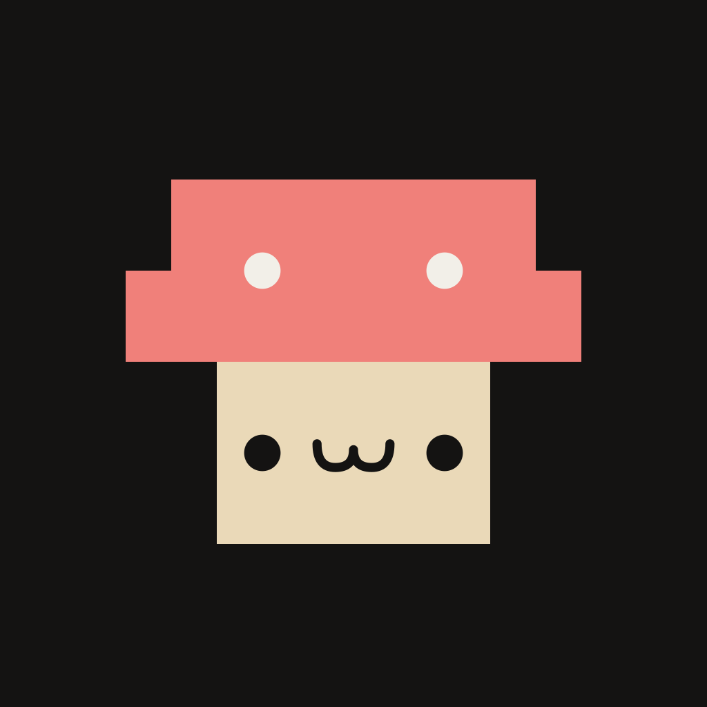
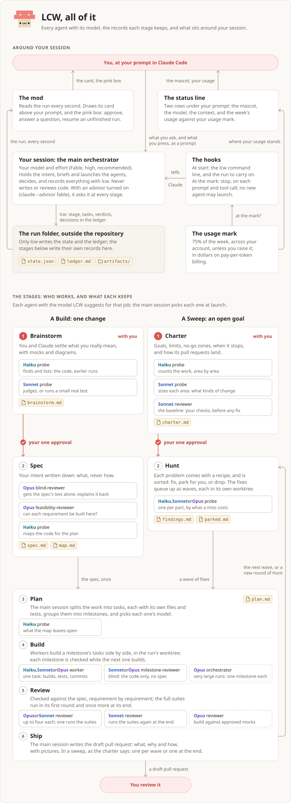

<p align="center">
  
</p>

<h1 align="center">LCW: Large Change Workflow</h1>

<p align="center">Tell Claude what you want built. Come back to a pull request. A Claude Code plugin.</p>

<p align="center">
  
</p>

The card above the prompt shows the stage, the tasks, each agent with its model and tokens, and anything waiting on you; the two rows under it show the model, context and week's usage against the mark. Talk to an agent by clicking it, or ctrl+x, Tab, Tab, Enter.

## Install

```
/plugin marketplace add rossetv/lcw
/plugin install lcw@lcw
```

The rows turn on by themselves, unless you already have a status line; then say "set up LCW". If the rows ever go missing, `~/.lcw/statusline.log` says why; if it has nothing, say "set up LCW". Needs macOS or Linux, Node 18 or later, and git.

## Then just ask

"Add shared lists to the to-do app" is a large change: a Build.

"Find and fix the bugs in the API" is an open goal: a Sweep.

A small change is just made when you say yes, with no run.

## How it works

<p align="center">
  
</p>

<details>
<summary><b>The full architecture</b></summary>
<br>
<p align="center">
  
</p>
Every stage, its agents and their models, and the records each keeps in a run folder outside your repository.
</details>

[An example pull request](https://github.com/rossetv/lcw/pull/11) · [Billing and external quota](docs/quota-command.md) · [License](LICENSE)
